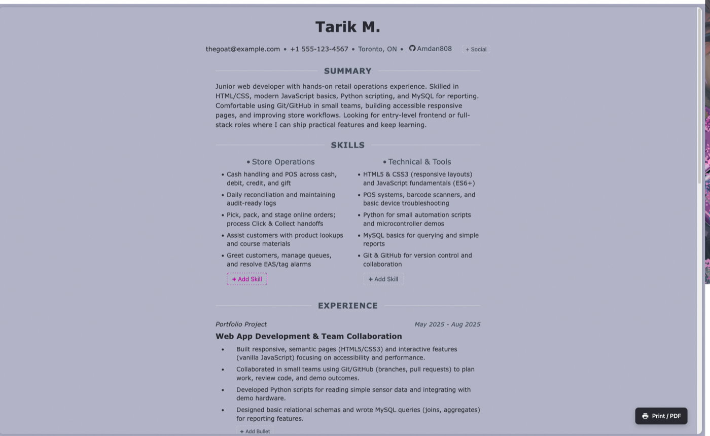
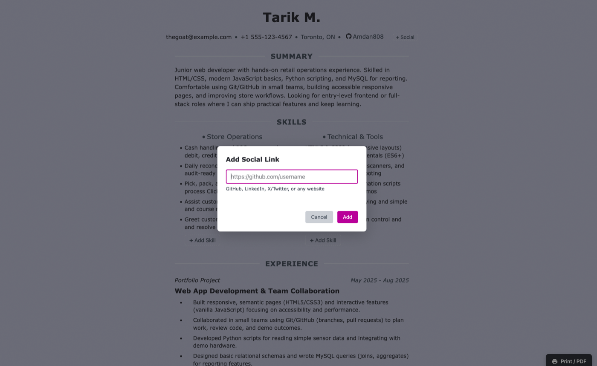
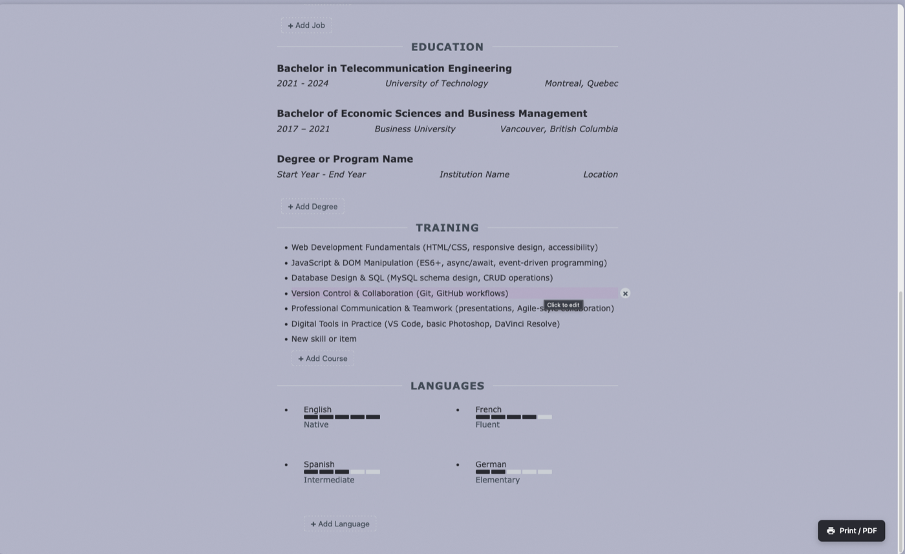
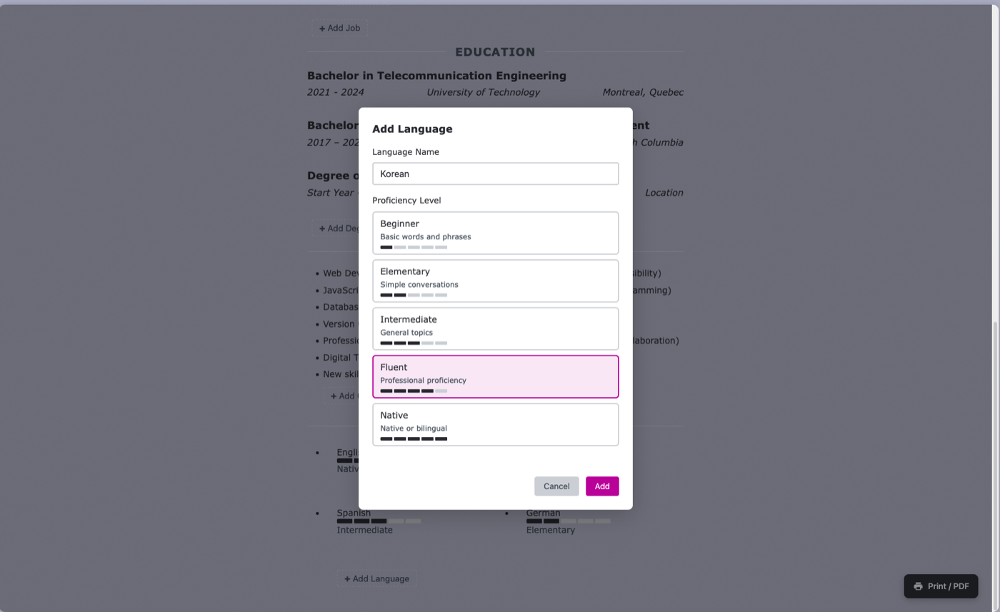
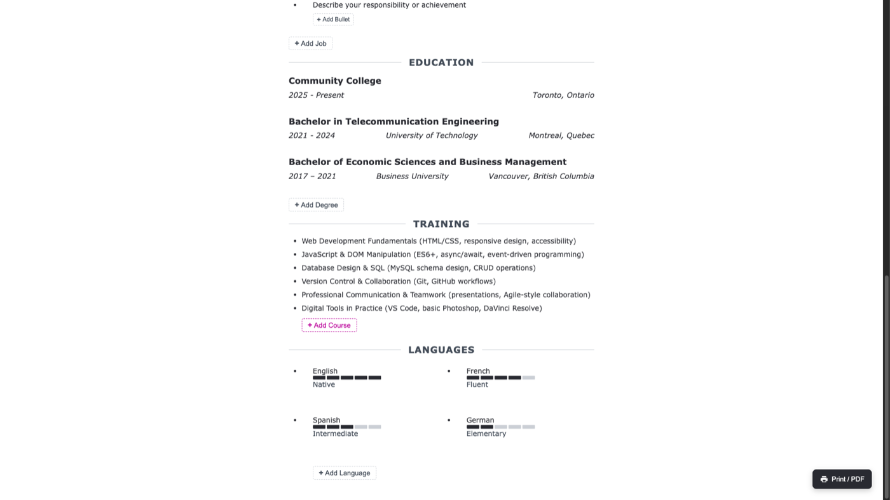
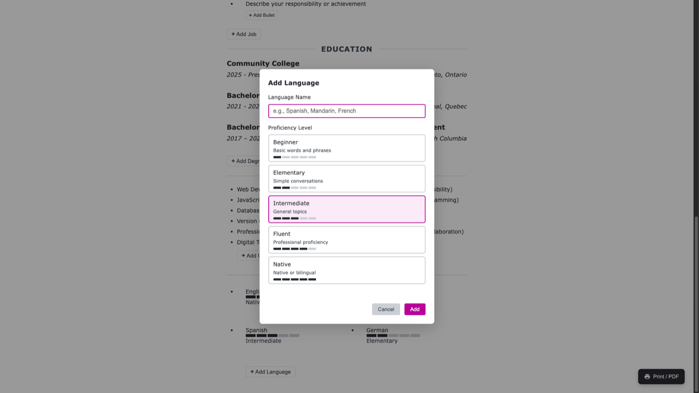
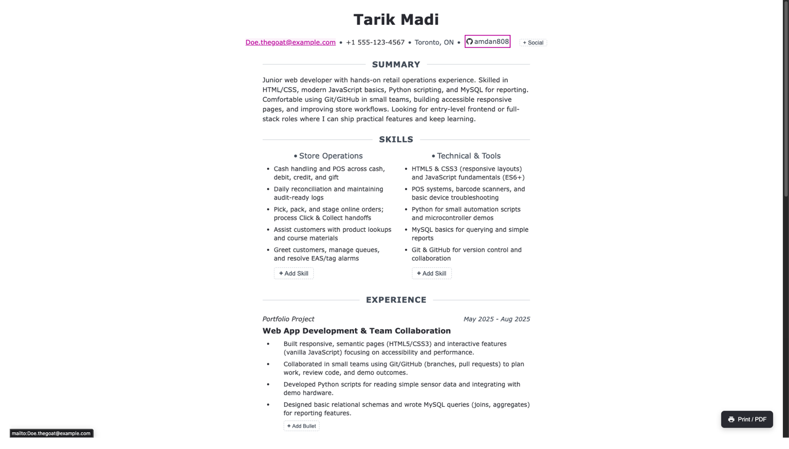
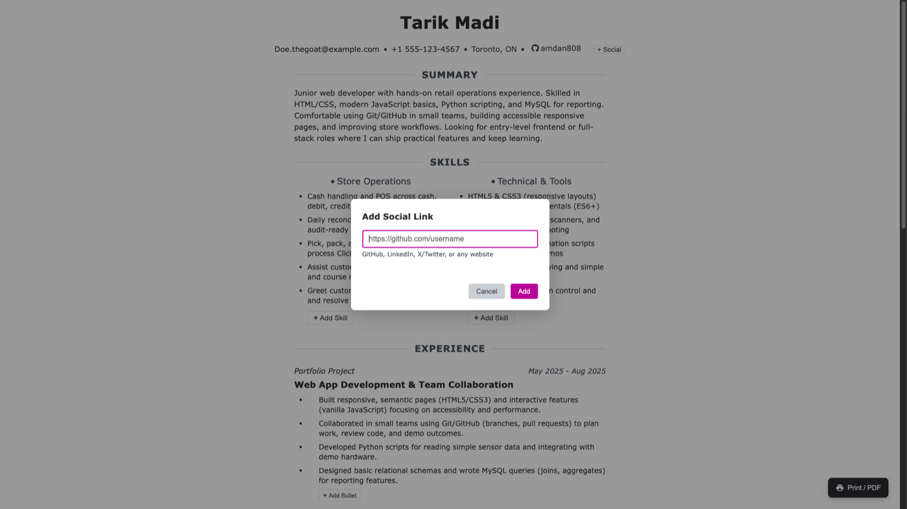

# Resume Builder

A clean, print-ready resume template with inline editing, built with plain HTML, CSS, and JavaScript. No frameworks, no build tools - just open `index.html` in a browser.

## Features

- Print-optimized: A4 layout with page breaks, orphan/widow control, and URL display for links
- Responsive: Mobile-friendly layout that adapts to screen size
- Accessible: Semantic HTML, skip link, and keyboard-friendly editing
- Inline editing: Click any field and edit in place
- List controls: Add/remove items for skills, experience, education, training, and languages
- Social links: Add profiles with platform detection and icons
- Local persistence: Edits auto-save in localStorage
- No dependencies: Pure HTML/CSS/JS, works offline

## Quick Start

1. Open `index.html` in your browser.
2. Click text to edit and type your changes; click outside to save.
3. Use the "+" buttons to add items or the remove button to delete items.
4. Click "Print / PDF" or press Ctrl/Cmd + P.

## Screenshots

<p>
  
  
</p>
<p>
  
  
</p>
<p>
  
  
</p>
<p>
  
  
</p>

## Editing Notes

- Single-line fields: Enter saves; Esc cancels any edit.
- Multiline fields: Use Shift+Enter or Ctrl+Enter to save, or click outside to save.
- Tab moves to the next editable field; Shift+Tab goes back.
- Language proficiency: Click the meter bar or label to change the level.
- Changes are saved in `localStorage` under `resume-builder:snapshot:v4` as the resume JSON.
- The default resume is the JSON in the `#resume-data` script tag in `index.html`. If you edit that seed, clear the storage key (or use a fresh browser profile) to see the new base content.

## How It Works

The resume is data-driven. `index.html` contains an inline JSON block
(`<script type="application/json" id="resume-data">`) and two empty containers.
On load, `js/script.js` renders that JSON into the page (`renderResume`), and
every edit is serialized back to the same JSON shape (`serializeResume`) and
saved to `localStorage`. Saved data takes precedence over the inline seed.

## File Structure

```
resume-builder/
├── index.html          # Resume data (inline JSON) + render containers
├── assets/
│   └── screenshots/    # README images
├── css/
│   ├── style.css       # Screen styles and design tokens
│   └── print.css       # Print-specific optimizations
├── js/
│   └── script.js       # Render, inline editing, list controls, persistence
```

## Customization

### Design Tokens

Edit CSS custom properties in `css/style.css`:

```css
:root {
  --ink: #2e3038; /* Main text color */
  --muted: #4b5563; /* Secondary text */
  --rule: #d1d5db; /* Divider lines */
  --link: #c200a7; /* Link/accent color */
  --name: 2.25rem; /* Name font size */
  --sections: 1.225rem; /* Section heading size */
}
```

### Content

Edit the JSON in the `#resume-data` script tag in `index.html`. Top-level keys:

- `header`: Name, contacts (email/phone/location), and social links
- `summary`: Professional summary paragraph
- `skills`: Array of `{ category, items[] }` groups (two-column layout)
- `experience`: Work history `{ company, title, startDate, endDate, bullets[] }`
- `education`: Degrees `{ degree, institution, location, startYear, endYear }`
- `training`: Array of course/certification strings
- `languages`: Array of `{ name, level }` (level 1–5 → proficiency meters)

The renderer marks elements with `data-editable` (editable in the browser) and
`data-list` containers (add/remove controls). Browser edits are serialized back
to this same JSON shape and persisted to `localStorage`.

### Print Settings

For best results when printing to PDF:

- Use Chrome or Edge for most consistent output
- Set margins to "Default" or "None" (the CSS handles margins)
- Enable "Background graphics" if you want meter bars to show
- Disable headers/footers for a cleaner look

## Browser Support

- Chrome (recommended for printing)
- Firefox
- Safari

## Development

Lint CSS with Stylelint:

```bash
npm install
npm run lint:css
npm run lint:css:fix  # Auto-fix issues
```

## License

ISC
